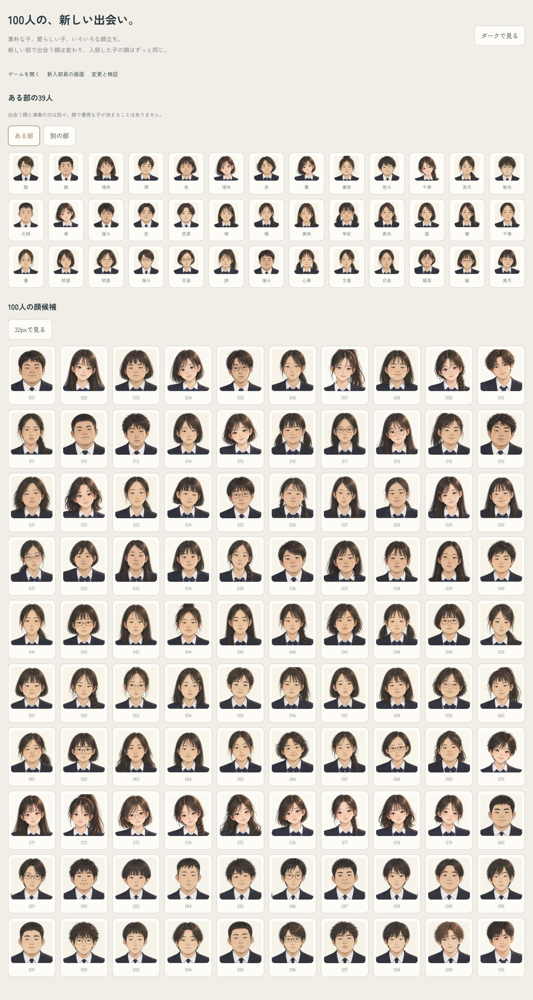

# 100人の顔候補と、評判による出会い

2026年10月26日。`codex/design` の別worktreeで実装。pushなし。

## 顔候補

- 39人から100人へ拡張。女子71・男子29。整った顔は女子18・男子3、ほか79人は素朴な顔立ち。これは絵の内訳で、入部する男女比を固定するものではない。
- 元の39人の原画・番号・名前との対応を維持。新規の60人と、同じ承認済み原画の未使用だった男子1人を追加した。高1寄りの年齢感、輪郭・目・眉・口・髪・小物の差を指定した。
- 組み込みimage_genで制作し、男子の首元だけをネクタイに修正。プロンプトと原稿は [sources.json](sources.json)。新原画6枚は各190〜200KB、各セル約397px。外部の画像やダウンロードなし。
- 新しい部では候補の順を混ぜて顔を選び、入部後はidから同じ顔を出す。再読み込み・進級・卒業・録音でも固定。昔のidは元の39人の配役で固定。
- 39人の見本では、異なる顔が38種類と37種類。一致する顔が完全に出なくなる仕組みではない。
- 顔と演奏の力は別々に決まる。原画10枚・舞台用の丸い画像100個を上限に再利用し、部員の保存データに絵や顔番号を足さない。

## ランダム性と評判

- 新しい部を始めると `recruitSeed` が変わり、出会う部員の名前・希望楽器・性格・初期能力と顔の組み合わせが変わる。種を保存し、読み込み直しで引き直さない。
- 前のセーブでは `load()` で種だけを補う。部員・入部待ちの子・過去の結果を作り直さない。形式はv2のまま、追加の種を任意項目として読む。
- 評判35までは通常の初心者・経験者。35を超えると、ときどき優秀な経験者が来る。評判60で約5.4％、100でも14％。最初の5人には出ない。
- 同じ候補5000人の検証では、評判60で258人、100で709人。高評価でも全員が優秀にはならない。
- 優秀な経験者は、得意だった楽器なら基礎能力に26点、別の楽器なら15点を加える。入部後も練習が必要。顔の見た目では判別できない。
- 入部時の表示は「経験あり」の位置を「中学で実績」に置き換える。能力は引き続きG〜Sのランクで見せる。
- 本番予測のキャッシュにもセーブの種を含め、別の部の予測が混じるのを防ぐ。

## 確認

- `node tsukurikata/tools/check_recruits.js`：出会いの変化、保存後の固定、5000人ずつの評判比較、得意楽器と別の楽器の初期能力、旧セーブ、前の顔、名前との対応、別セーブの予測を確認。[結果](recruit-checks.json)。
- `check_faces.js`：100候補と元の39人の内訳、名前、保存内容不変、キャッシュ、解像度、200KB以下を確認。
- `check_stage_faces.js`：240〜720pxの間隔・タップ、昔の録音の本人、原画10枚・丸い画像100個の再利用を確認。
- `check_lineup_scoring.js`：全15曲で人選と厚みの採点を再確認。
- 全15曲で `sim_avg.sh` を各10回、3年分実行。[早送り結果](sim-after.txt)。県大会の平均範囲は1年目38.1〜42.6、2年目62.4〜69.0、3年目71.7〜75.5点。2年目55〜67・3年目65〜75の育成目安から一部外れる（[一覧](simulation.json)）。
- 375pxのライト・ダークで、入部・合奏・カード・一覧・今週・相談・卒業式・本番を確認。50手で2027年度へ進行。横幅375px、コンソールエラーなし。[記録](screenshots/checks.json)。
- 新たに足りない文字なし（従来の操作・楽譜用の5記号のみ）。
- Releaseビルド・iPhoneへの更新・起動成功。HTML・関連JS・6枚の追加原画・目録・出典の同梱内容が現在の作業内容と一致。[ビルド記録](iphone-build.json)。

[100人をブラウザで見る](index.html)

