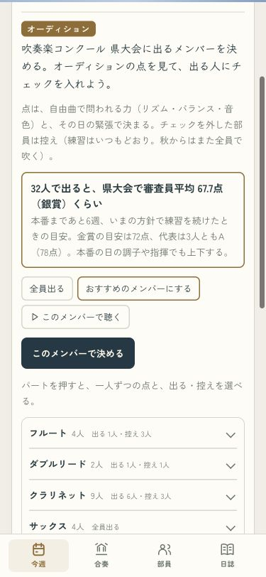
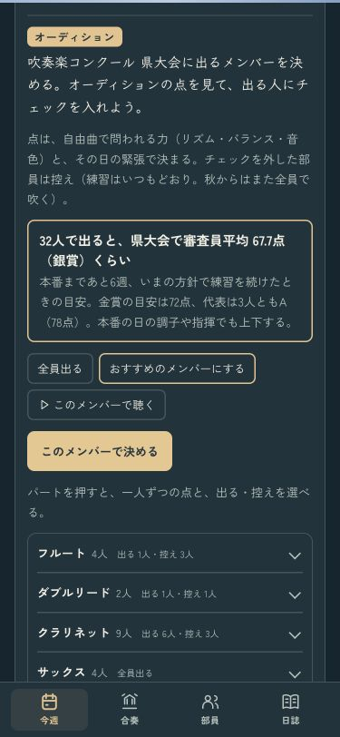
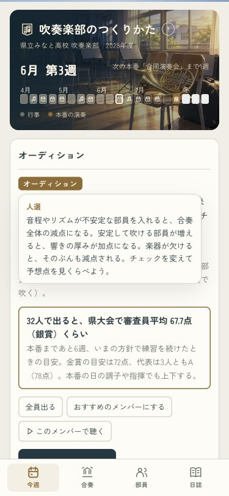

# 人選と合奏の厚み

不安定な奏者の音が平均に埋もれないよう、一人ずつの音程・リズム・音色・取り違えを測る。育った部で大きく乱す奏者は強く減点する（追加の減点は最大20点）。安定した音の重なりは最大4点加点する。学年やランクで一律に足切りしない。

コンクール・演奏会と、人選の予想点に共通の採点を使う。おすすめは大まかな人数比較のあと、一人だけ外す・戻す境目も比較する。全組み合わせの最適解を保証するものではない。必要な楽器の欠員と少人数の減点も残す。

人選の説明は既存の「オーディション」を押す吹き出し。常設の文章は増やさない。講評には必要に応じて乱れ・厚みの理由を表示する。

成長率・名前・顔・セーブ形式・過去の受賞結果は変更しない。

## 同じ条件での比較

「天国と地獄」、同じ本番条件・譜読み済みの検証用の部。審査員平均。差は曲・受け持ち・実力で変わる。

|編成|点|
|---|---:|
|安定した20人|80.7|
|その20人＋苦手な1人|67.3|
|その20人＋苦手な5人|47.7|
|安定した39人|87.7|

## 確認

- `node tsukurikata/tools/check_lineup_scoring.js`：全15曲で苦手な人の追加・安定した大編成の利点・欠員・空編成・旧録音からの再演奏・保存内容不変・A部門2曲の予想と採点の一致を確認。詳細は [checks.json](checks.json)。
- `sim_avg.sh`：変更前後それぞれ全15曲×10回×3年。おまかせ練習・おすすめ人選。独立した乱数試行なので、細かな差にはばらつきを含む。[変更前](sim-before.txt)・[変更後](sim-after.txt)。
- 375px、ライト・ダーク、人選のチェック・おすすめ・予想点・吹き出しを操作。横幅375pxのまま。1年を49手で進めて2027年度へ到達、コンソールエラーなし。[ブラウザ記録](browser-check.json)。
- 顔・舞台の既存テスト通過。文字チェックは追加の不足なし（既存の記号5字のみ）。
- Releaseビルド・iPhoneへの更新・起動成功。主要4ファイルの同梱内容一致。[ビルド記録](iphone-build.json)。実機での目視はオーナーに依頼。

## 育成バランスの結果と限界

県大会の平均範囲は1年目36.3〜42.5、2年目61.9〜69.8、3年目70.6〜76.4点。基準の37〜47／55〜67／65〜75から一部外れる。変更前にも範囲外の曲があり、今回は人選の効果を入れ、成長率や各曲の倍率を別途書き換える調整はしていない。範囲外は [simulation.json](simulation.json) の `outsideTarget` に記録。

## 画面

